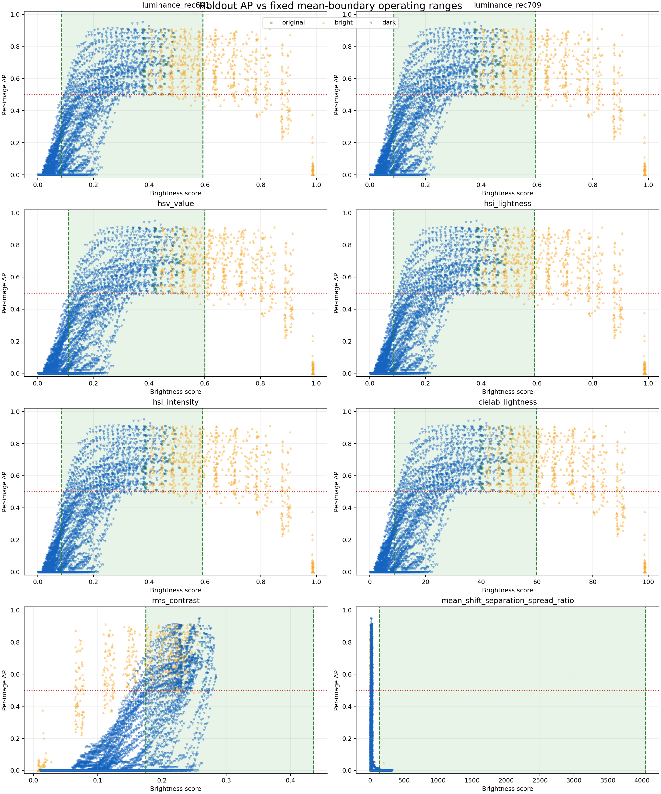
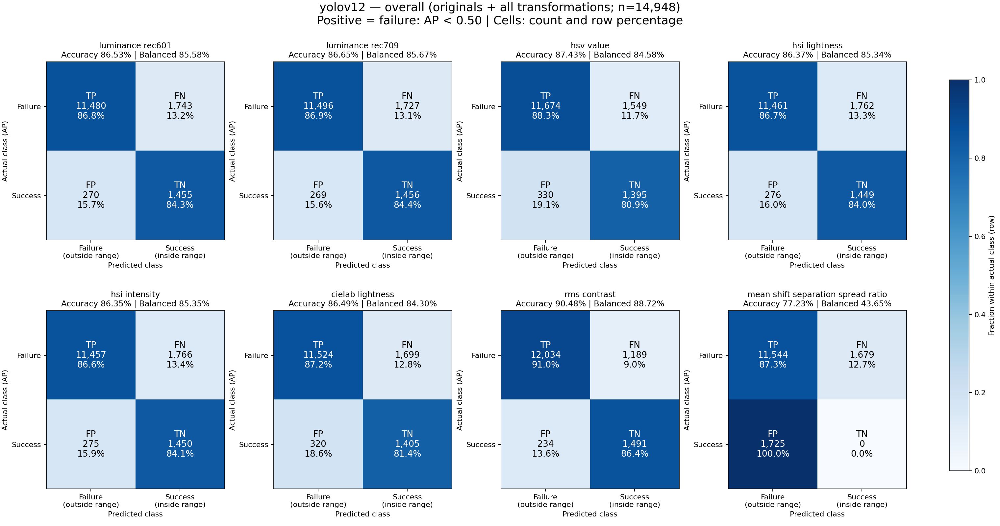
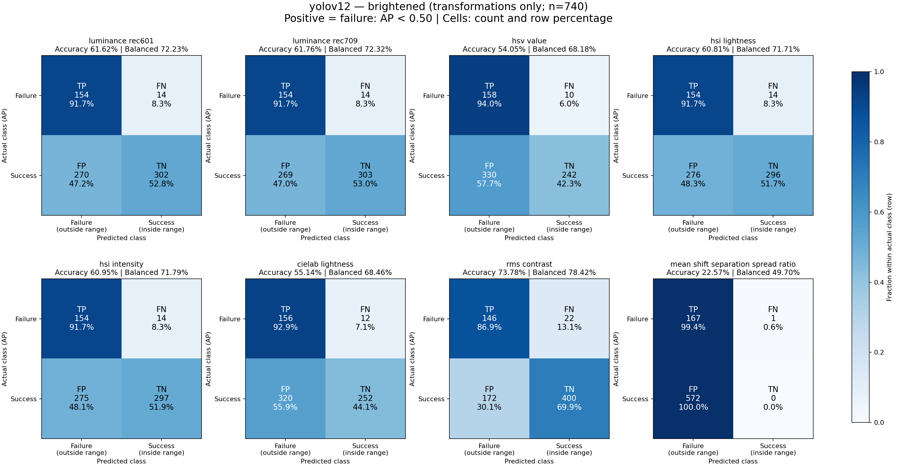
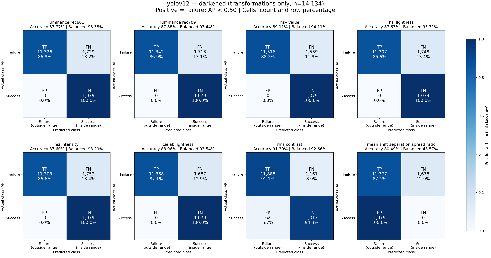

# RQ2b Holdout Brightness Validation: yolov12

## Design

Only original holdout images with per-image COCO AP@[0.50:0.95] ≥ 0.50 were eligible. For each eligible image, the full RQ2a brute-force gamma grid was evaluated. All transformations were retained, including AP at or above the threshold; no interpolation or AP-based selection was used.

The operating ranges were fixed before validation using the unadjusted RQ2b boundary means: lower = dark/right mean and upper = bright/left mean. Eligible originals are successful controls.

Images checked: **139**; eligible originals: **74**; transformations: **14874**; transformed successes: **1651**; transformed failures: **13223**.

## Fixed mean-boundary ranges

| Method | Dark mean | Dark SD | Lower | Bright mean | Bright SD | Upper |
|---|---:|---:|---:|---:|---:|---:|
| luminance_rec601 | 0.085995 | 0.057151 | 0.085995 | 0.59288 | 0.069892 | 0.59288 |
| luminance_rec709 | 0.087065 | 0.05838 | 0.087065 | 0.59334 | 0.06988 | 0.59334 |
| hsv_value | 0.11146 | 0.066445 | 0.11146 | 0.6011 | 0.067566 | 0.6011 |
| hsi_lightness | 0.08697 | 0.05591 | 0.08697 | 0.59176 | 0.069801 | 0.59176 |
| hsi_intensity | 0.086373 | 0.056688 | 0.086373 | 0.59213 | 0.069825 | 0.59213 |
| cielab_lightness | 9.0197 | 6.1813 | 9.0197 | 59.857 | 6.701 | 59.857 |
| rms_contrast | 0.17517 | 0.078425 | 0.17517 | 0.43565 | 0.034884 | 0.43565 |
| mean_shift_separation_spread_ratio | 140.21 | 489.04 | 140.21 | 4050.6 | 8029.7 | 4050.6 |

## Validation results

| Rank | Method | Failure recall | Bright recall | Dark recall | Original acceptance | Transformed success acceptance | All success acceptance | Balanced accuracy | MCC | TP | FP | TN | FN |
|---:|---|---:|---:|---:|---:|---:|---:|---:|---:|---:|---:|---:|---:|
| 1 | rms_contrast | 0.910 | 0.869 | 0.911 | 1.000 | 0.858 | 0.864 | 0.887 | 0.645 | 12034 | 234 | 1491 | 1189 |
| 2 | luminance_rec709 | 0.869 | 0.917 | 0.869 | 1.000 | 0.837 | 0.844 | 0.857 | 0.557 | 11496 | 269 | 1456 | 1727 |
| 3 | hsv_value | 0.883 | 0.940 | 0.882 | 1.000 | 0.800 | 0.809 | 0.846 | 0.556 | 11674 | 330 | 1395 | 1549 |
| 4 | luminance_rec601 | 0.868 | 0.917 | 0.868 | 1.000 | 0.836 | 0.843 | 0.856 | 0.554 | 11480 | 270 | 1455 | 1743 |
| 5 | hsi_lightness | 0.867 | 0.917 | 0.866 | 1.000 | 0.833 | 0.840 | 0.853 | 0.550 | 11461 | 276 | 1449 | 1762 |
| 6 | hsi_intensity | 0.866 | 0.917 | 0.866 | 1.000 | 0.833 | 0.841 | 0.854 | 0.550 | 11457 | 275 | 1450 | 1766 |
| 7 | cielab_lightness | 0.872 | 0.929 | 0.871 | 1.000 | 0.806 | 0.814 | 0.843 | 0.540 | 11524 | 320 | 1405 | 1699 |
| 8 | mean_shift_separation_spread_ratio | 0.873 | 0.994 | 0.871 | 0.000 | 0.000 | 0.000 | 0.437 | -0.128 | 11544 | 1725 | 0 | 1679 |

## Classification by transformation direction

Accuracy is the fraction correctly classified: AP below the threshold and outside the operating range, or AP at/above the threshold and inside it. Each table uses only its stated direction; original images are excluded. Balanced accuracy averages successful-image acceptance and failure rejection.

### Brightened images (gamma < 1)

Images: **740**; successes: **572**; failures: **168** (AP threshold: 0.50).

| Method | Correct / total | Accuracy | Balanced accuracy | Successful images accepted | Failures rejected |
|---|---:|---:|---:|---:|---:|
| luminance_rec601 | 456 / 740 | 61.62% | 72.23% | 52.80% | 91.67% |
| luminance_rec709 | 457 / 740 | 61.76% | 72.32% | 52.97% | 91.67% |
| hsv_value | 400 / 740 | 54.05% | 68.18% | 42.31% | 94.05% |
| hsi_lightness | 450 / 740 | 60.81% | 71.71% | 51.75% | 91.67% |
| hsi_intensity | 451 / 740 | 60.95% | 71.79% | 51.92% | 91.67% |
| cielab_lightness | 408 / 740 | 55.14% | 68.46% | 44.06% | 92.86% |
| rms_contrast | 546 / 740 | 73.78% | 78.42% | 69.93% | 86.90% |
| mean_shift_separation_spread_ratio | 167 / 740 | 22.57% | 49.70% | 0.00% | 99.40% |

### Darkened images (gamma > 1)

Images: **14134**; successes: **1079**; failures: **13055** (AP threshold: 0.50).

| Method | Correct / total | Accuracy | Balanced accuracy | Successful images accepted | Failures rejected |
|---|---:|---:|---:|---:|---:|
| luminance_rec601 | 12405 / 14134 | 87.77% | 93.38% | 100.00% | 86.76% |
| luminance_rec709 | 12421 / 14134 | 87.88% | 93.44% | 100.00% | 86.88% |
| hsv_value | 12595 / 14134 | 89.11% | 94.11% | 100.00% | 88.21% |
| hsi_lightness | 12386 / 14134 | 87.63% | 93.31% | 100.00% | 86.61% |
| hsi_intensity | 12382 / 14134 | 87.60% | 93.29% | 100.00% | 86.58% |
| cielab_lightness | 12447 / 14134 | 88.06% | 93.54% | 100.00% | 87.08% |
| rms_contrast | 12905 / 14134 | 91.30% | 92.66% | 94.25% | 91.06% |
| mean_shift_separation_spread_ratio | 11377 / 14134 | 80.49% | 43.57% | 0.00% | 87.15% |

## RMS contrast

RMS rejected **12034 of 13223** transformed failures and accepted **1491 of 1725** successful images (original and transformed). Failure recall: **0.910**; transformed success acceptance: **0.858**; MCC: **0.645**.

Success acceptance is the fraction of images with AP at or above the threshold whose brightness score is inside the operating range. Balanced accuracy uses failure recall and acceptance of all successful images. TP/FP/TN/FN include originals and every transformation.

## Sample images

Representative too-dark, in-range, and out-of-range images for each valid method are in `sample_images/<method>`. Each method directory contains a JSON manifest with the fixed bounds and image metadata. The out-of-range set includes both dark and bright violations and therefore intentionally overlaps the too-dark set.

## Confusion matrices

Failure (AP below the threshold) is the positive class. Rows show actual failure/success; columns show predicted failure (outside range)/success (inside range). Cells show counts and percentages within each actual class; colour uses the same 0–100% scale for every method. Overall includes eligible originals and all transformations; directional plots exclude originals.

